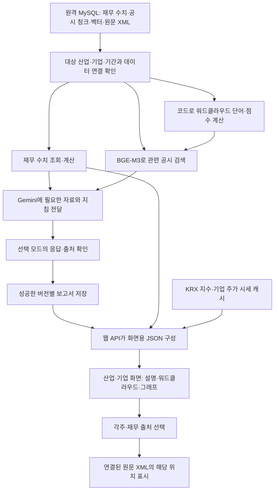

# DART BIG:IN — 발표용 서비스 구조와 설계 의도

작성 기준: 2026-10-12의 로컬 코드와 `deploy/` 코드. 이 문서는 **DB에 자료가 적재된 이후부터 웹 화면에 표시되기까지** 현재 구현된 과정을 설명한다. 원격 DB와 서버의 상태를 이번 문서 작성 과정에서 새로 점검한 것은 아니며, 데이터 개수나 특정 기업의 최신 실적을 설명하는 문서는 아니다.

## 1. 먼저 이 서비스를 한 문장으로 소개한다

**DART BIG:IN은 공시의 사업 설명과 재무 수치를 함께 읽어, 산업과 기업에 어떤 변화가 나타나는지 쉽게 살펴보고 그 근거까지 확인하는 서비스다.**

사용자는 관심 산업을 선택한 다음 시장의 움직임, 공시의 주요 키워드, AI 설명, 기업별 재무 흐름을 살펴본다. 관심 기업으로 들어가거나 설명의 각주를 누르면 더 구체적인 내용과 공시 원문을 확인할 수 있다.

이때 역할을 나누는 것이 핵심이다. **코드는 자료를 찾고 숫자를 계산하며, AI는 전달받은 자료를 이해하기 쉬운 문장으로 설명한다.** AI가 DB 전체를 자유롭게 읽거나 그래프 값을 만들어내는 구조는 아니다.

## 2. 발표에서 바로 사용할 수 있는 짧은 설명

> 저희 서비스는 긴 공시 문서를 처음부터 읽기 어려운 사용자가 산업과 기업의 변화를 이해하도록 돕습니다. 사용자는 산업을 고르고, 주요 공시 키워드와 AI 설명을 읽은 뒤, 재무 그래프와 원문으로 내용을 확인할 수 있습니다.
>
> 시스템은 이미 DB에 저장된 재무 수치, 공시 문단, 문단의 검색용 벡터와 원본 XML을 사용합니다. 먼저 산업·기업·기간을 맞춰 자료를 조회합니다. 숫자는 코드로 계산하고, 사업 설명은 질문과 뜻이 가까운 공시 문단을 찾아 AI에게 전달합니다. 이렇게 필요한 자료를 찾아 AI가 설명하도록 하는 방식이 RAG입니다.
>
> 공시 워드클라우드는 AI가 임의로 고르는 것이 아닙니다. 코드가 단어의 언급 비율, 최근 변화, 산업 내 확산이나 기업 내 문맥 다양성을 계산합니다. 최신 자료가 반기까지 있다면 직전 연도도 같은 보고서 종류끼리 비교하여 기간 차이로 인한 왜곡을 줄입니다.
>
> AI 설명은 생성 후 바로 공개하지 않습니다. 기본 mvp에서는 입력 근거와 표시할 공시 문장 위치를 확인하고, strict 모드에서는 점수와 수치·비교 기준까지 정밀 검사합니다. new2 분석은 재무 변화와 사업 정보를 함께 설명하도록 하되, 인과관계가 확인되지 않으면 두 흐름을 나란히 설명하게 합니다.
>
> 해당 모드의 처리와 데이터 확인을 마친 보고서는 저장하고, 웹페이지에서는 그 결과를 읽습니다. 방문할 때마다 전체 AI 분석을 반복하지 않으므로 속도와 API 사용량을 관리할 수 있습니다. 사용자가 각주를 선택하면 해당 설명에 연결된 원문 위치를 보여줍니다. 이처럼 빠르게 이해하는 화면과 근거를 확인하는 과정을 함께 제공하도록 설계했습니다.

## 3. 전체 흐름은 두 과정으로 나누면 이해하기 쉽다

첫 번째는 관리자가 실행하는 **보고서 생성 과정**, 두 번째는 사용자가 웹페이지를 여는 **화면 조회 과정**이다. 보고서 생성은 자료 검색과 AI 호출 때문에 시간이 걸릴 수 있다. 화면 조회는 이미 성공한 보고서를 사용하며, 필요한 시세와 재무 그래프 자료를 결합한다.



워드클라우드 계산에 필요한 공시를 읽는 작업과, 선택된 단어를 설명할 공시를 검색하는 작업은 구별한다. 도표의 두 경로는 이 차이를 나타낸다. 원본 XML은 주로 원문 표시와 필요한 재무 대체 추출에 사용하며, 전문 전체를 매번 Gemini에 보내지 않는다.

## 4. DB에는 서로 다른 역할의 재료가 들어 있다

자료를 이해할 때는 아래 네 가지로 나누면 된다. 이는 현재 서비스가 읽는 원격 MySQL의 역할 구분이며, 과거의 로컬 SQLite·Qdrant 구성을 현재 서비스 구조로 설명한 것이 아니다.

| 자료 | 쉬운 설명 | 서비스에서 사용하는 목적 |
| --- | --- | --- |
| 표준화된 재무 수치 | 기업·기간·회계 기준을 붙인 숫자 | 그래프 계산, 재무 변화 확인, AI의 재무 입력 |
| 공시 청크 | 긴 공시를 검색하기 좋게 나눈 본문 조각 | 사업 설명 검색, 워드클라우드 계산, 인용 문장 확인 |
| 청크 벡터 | 공시 조각의 뜻을 숫자 배열로 표현한 값 | 검색 질문과 가까운 공시를 찾는 데 사용 |
| 원본 XML과 연결 정보 | 실제 공시 원문과 청크가 나온 문서의 연결 | 각주 위치·원본 표 표시, 필요한 수치의 대체 추출 |

대표적인 조회 대상은 `standardized_financials`, `financial_facts`, `capex_facts`, `financial_metric_values`, `chunk_metadata`, `chunk_embeddings`, `filings`, `filing_source_documents`, `chunk_source_documents`다. 산업·기업 관계와 자료 준비 상태는 별도 목록·coverage·버전 테이블에서 읽는다.

**왜 분리했는가?** “매출액이 얼마인가”는 정확한 항목과 기간을 조회해야 하는 문제다. “어떤 사업을 확대하고 있는가”는 문장의 뜻과 맥락을 찾아야 하는 문제다. 원문을 확인하는 데에는 문서와 위치 정보가 필요하다. 각각에 맞는 자료를 사용하면 AI에게 모든 문제를 한꺼번에 맡기는 일을 줄일 수 있다.

## 5. 자료를 읽기 전에 분석 범위와 연결을 확인한다

서비스는 먼저 DB의 산업 목록과 지수 구성기업 관계를 읽는다. 그중 운영 가능한 기업을 분석 대상으로 삼고, 사용자가 기업이나 연도를 지정하면 범위를 좁힌다. `--years`를 생략하면 해당 조회 버전의 coverage에 있는 전체 연도를 사용한다. 현재 서비스가 항상 3개년으로 고정되는 것은 아니다.

이어서 청크와 벡터의 ID·개수·모델 정보가 연결되는지 확인한다. 검색용 벡터가 다른 본문에 연결되어 있다면 비슷한 뜻을 잘 찾아도 엉뚱한 공시가 반환될 수 있기 때문이다. 질문을 벡터로 바꾸는 모델도 저장 벡터와 같은 모델·리비전·차원·정규화 조건을 사용한다. 표본 청크를 다시 임베딩하여 저장 벡터와 일치하는지 확인하는 검사도 있다.

버전명이 다르다는 이유만으로 모든 연결을 금지하지는 않는다. 코드에 정해진 내용 해시와 재무 동등성 등의 조건을 충족한 자산은 호환 여부를 확인한다. 다만 다른 버전을 임의로 섞거나 이름이 비슷하다는 이유로 승인하지 않는다. 별도 조회 버전을 지정하는 경우에도 승인 조건을 검사한다.

**왜 이렇게 설계했는가?** 실제 자료를 갱신할 때에는 청크·벡터·원문이 한 번에 모두 바뀌지 않을 수 있다. 따라서 같은 자료인지 확인하는 절차가 필요하다. 분석 중에는 성공한 전체 검증을 재사용하고, 버전과 내용 해시 등의 식별 정보가 바뀌면 전체 검증을 다시 수행한다. 검증을 매 검색마다 반복하는 부담을 줄이면서 변경 감지는 유지하려는 설계다.

## 6. 숫자는 코드로 정리하고 계산한다

### 6.1 같은 숫자처럼 보여도 기준을 먼저 맞춘다

재무 수치는 기업·연도·보고서 종류뿐 아니라 연결/별도, 누적/단일 분기, 단위와 접수번호를 확인해야 한다. 연결은 그룹을 포함한 기준이고, 별도는 해당 법인 중심의 기준이다. 누적 반기 수치를 단일 2분기 수치로 잘못 사용하면 그래프와 변화 설명이 모두 틀릴 수 있다.

단일 분기 값이 있으면 이를 우선한다. 없으면 비교 가능한 누적값의 차이로 계산한다. 예를 들어 1분기 매출 100, 상반기 누적 매출 230이면 2분기 매출은 130이다. 조건이 맞고 다른 세 분기가 모두 있으면 연간값에서 이를 차감하는 경로도 있다. 연간 수치를 단순히 4로 나누지는 않는다.

### 6.2 없는 자료를 0으로 만들지 않는다

필요한 값이나 비교 기준이 없으면 계산 결과를 비워 둔다. CAPEX는 취득 지출인지, 부호와 구성 항목이 적절한지 추가로 확인한다. 검증되지 않은 값을 절댓값으로 바꾸어 정상 수치처럼 표시하지 않는다. 주성엔지니어링에는 요청에 따라 건물·토지·기계·건설중인자산 등의 취득액을 합산하는 별도 규칙이 있다.

표준화 재무 자료가 없거나 선택 공시와 접수번호가 다른 경우, 지원되는 항목은 **선택한 공시 XML**에서 다시 추출할 수 있다. 확인 가능한 값만 사용하며, 불일치 대체값에는 추정·정정공시 가능성 안내를 연결한다. XML에서도 값을 확인할 수 없거나 값이 충돌하면 비워 둔다. 모든 누락을 자동으로 복원한다는 뜻은 아니다.

### 6.3 산업의 성격에 맞게 지표를 바꾼다

현재 화면은 단순 재무금액 합계 대신 기업별 분기 흐름을 보여준다. 일반 산업은 매출 지수·영업이익률·CAPEX/매출액·FCF Margin을 사용한다. 헬스케어는 투자 비율 자리에 R&D/매출액을, 은행은 순이자이익 지수·ROE·대손비용률 proxy·자기자본비율을 사용한다. 은행의 연환산 지표와 proxy가 공식 규제·공시 지표와 동일하다고 설명하지 않는다.

그래프 뒤쪽의 비어 있는 미래 분기는 실제 재무 값이 있는 최신 분기까지만 표시한다. 산업 비교표도 같은 최신 분기를 사용하고 자료가 없는 기업은 이전 값을 가져오지 않는다. 연간 보고서가 없는 연도도 실제 분기 자료에서 회계 기준을 선택한다. 산업 화면의 매출 지수는 공통 시작 분기를 기준으로 비교한다. 기업 화면은 실제 공시가 시작하는 구간부터 보여주고, 표시 기간 중 매출이 처음 확인되는 분기를 100으로 다시 맞춘다. 서로 다른 화면의 기준 차이를 의도적으로 관리하는 것이다.

**왜 이렇게 설계했는가?** 큰 기업의 금액이 다른 기업의 흐름을 덮지 않도록 하고, 자료 누락을 실적 급락으로 오해하지 않게 하며, 산업별로 실제 의미가 있는 지표를 제공하기 위해서다. 그래프 계산은 AI 문장 생성과 분리되어 있다.

## 7. 사업 설명은 의미가 가까운 공시부터 찾는다

“고대역폭 메모리 생산능력 확대”를 찾는 상황을 생각해 보자. 코드는 먼저 선택 산업·기업·기간·보고서 종류에 맞는 청크를 조회한다. 그다음 검색 문구를 **BGE-M3**로 벡터로 바꾸고, 그 범위의 저장 벡터와 가까운 순서로 비교한다. 본문에 검색어와 완전히 같은 표현이 없어도 의미가 가까운 조각이 후보가 될 수 있다.

Windows의 기본 비교 방식은 NumPy, Linux의 기본 방식은 FAISS다. 현재 FAISS 경로는 정규화된 벡터의 내적을 사용하는 `IndexFlatIP`이며, NumPy도 같은 방향의 유사도를 계산한다. 이는 서비스가 MySQL에서 읽은 벡터를 실행 환경에서 검색하는 방식이다. 현재 기본 경로에 Qdrant 호출, 키워드 선별 후 벡터 중심점 만들기, 별도의 재순위 모델은 없다. `keyword`를 명시하면 별도의 단어 기반 검색 경로를 선택할 수 있다.

보고서 생성에서는 산업에 설정한 사업·투자·위험 등의 검색 주제로 기업별 자료를 찾고, 여러 보고서 시점의 후보를 확보한다. AI 입력은 기업들이 한쪽으로 치우치지 않도록 번갈아 담으며, 문맥을 보존한 청크를 문자 예산 안에서 전달한다. 이전 기간 근거와 인접 문맥을 덧붙이는 경로도 있지만, 인접 내용 전체가 자동으로 인용 가능한 각주가 되는 것은 아니다.

**왜 이렇게 설계했는가?** 공시 전문을 모두 넣으면 토큰 사용량이 커지고 중요한 내용이 묻힌다. 필요한 범위와 관련 문단을 먼저 찾으면 입력을 줄이고 출처를 추적하기 쉽다. 다만 검색에서 놓친 문단은 AI도 활용하기 어려우므로, 이 결과는 공시 전문의 모든 사실을 완전하게 검토한 결과라고 주장하지 않는다.

## 8. 워드클라우드는 공시의 관심사를 코드로 계산한다

워드클라우드는 사용자가 사업 내용을 읽기 시작하는 입구다. 한국어 형태소 분석과 산업별 어휘 규칙으로 후보를 찾고, 같은 뜻의 표기를 묶는다. 예를 들어 HBM 관련 세대 표기는 공통 표현으로 정리한다. 문서 작성·법률·홍보 표현이나 기업명 조각 등 사업 신호와 관계가 약한 후보는 걸러낸다. 원문을 삭제하는 작업은 아니다.

언급량은 **한 청크에 단어가 포함되었는지**로 센다. 같은 청크에서 열 번 반복해도 한 번이다. 이를 연도별 전체 대상 청크 수로 나눈 언급 비율을 사용하여 긴 문서가 무조건 유리해지는 일을 줄인다.

| 화면 | 점수에 사용하는 요소 | 의도 |
| --- | --- | --- |
| 산업 | 현재 언급 50% + 변화 30% + 기업 간 확산 20%, 감점 적용 | 여러 기업의 공통 관심사를 찾고 한 기업의 반복 설명에 치우치는 것을 줄임 |
| 기업 | 현재 언급 50% + 변화 30% + 문맥 다양성 20%, 감점 적용 | 한 기업의 서로 다른 사업 문맥에서 나타나는 주제를 찾음 |

최신 연도에 Q1·H1만 있으면 직전 연도도 공통으로 존재하는 Q1·H1만 비교한다. 유효한 연속 연도 차이는 순서대로 이전 결과 0.4·새 차이 0.6으로 결합한다. 과거 연도 사이의 비교는 확보된 해당 연도 전체 자료를 사용하므로 과거 자료의 완전성 차이는 영향을 줄 수 있다. 자료가 없는 해나 비교할 보고서 종류가 없는 구간은 제외하며, 비교 자체가 불가능하면 변화는 중립값 0이다.

최종 점수로 기본 최대 12개를 표시한다. 불꽃은 언급 비율이 증가한 상위 후보에만 붙이며, 산업·기업 모두 최대 3개다. 산업의 변화 점수 기준은 90, 기업은 97.5다. 글자 크기는 표시 가중치를 따르고, 화면에 맞춰 전체를 같은 비율로 확대·축소한다. 단어 색은 구분을 위한 장식이며 긍정·부정이나 점수의 뜻이 없다.

**왜 이렇게 설계했는가?** 매번 AI에게 단어를 고르게 하면 결과가 쉽게 달라진다. 단어 선정과 크기는 재현 가능한 규칙으로 계산하고, 선택한 단어의 뜻과 실제 사업 현황 설명만 AI에 맡긴다. 공시에서 많이 언급되었다는 사실을 실제 매출이나 수요의 증가로 바꾸어 해석하지 않는다.

## 9. AI는 자료를 설명하고, 코드는 응답을 확인한다

### 9.1 프롬프트 버전별로 설명 방식을 선택한다

`new`, `new2`, `old`를 선택할 수 있고 기본 분석 버전은 `new`다. `new`도 재무 자료를 입력으로 받지만, 최종 각주와 근거 검증은 자연어 공시 중심이다. `new2`의 산업·기업 인사이트는 출처와 계산 기준을 붙인 재무 근거도 내부 검증에 사용하며, 재무 흐름과 실제 사업 정보를 함께 설명하도록 요구한다. 지침은 두 종류의 적격 정보를 함께 설명하기 어려우면 부족 이유를 반환하도록 요구한다. 기본 mvp는 응답의 두 종류 근거 균형을 실패 조건으로 강제하지 않으며 strict에서 해당 조건을 검사한다.

new2에서 재무 분석·사업 검토·종합은 AI가 같은 생성 요청 안에서 수행하도록 지시한다. 각 단계마다 별도 LLM을 호출하는 다단계 파이프라인은 아니다. 최종 출력은 기존과 같은 짧은 문장과 근거 정보다. 산업·기업 인사이트는 1-3문장, 키워드 설명은 new와 같은 1-2문장 경로를 사용한다.

“이익률이 높아졌다”는 재무 사실과 “생산능력 확대를 계획한다”는 사업 사실이 함께 확인되어도, 그 계획이 이익률 개선의 원인이라고 자동으로 설명하게 하지 않는다. 직접적인 인과 근거가 없으면 두 정보를 병렬적으로 설명한다. new2의 산업 인사이트에는 기업명을 나열하거나 특정 기업에만 국한된 설명을 하지 않도록 하고, 필요하면 특정 사업군으로 범위를 좁힌다.

### 9.2 문장과 함께 실제 근거 ID를 받는다

Gemini에는 필요한 공시·재무 자료, 작업 지침, 반환 형식을 전달한다. 응답은 자유 형식의 긴 글 대신 문장·근거 ID·근거 평가가 들어 있는 JSON이다. 코드가 결과를 읽어 각주와 연결하려면 항목의 형태가 일정해야 하기 때문이다. 구글의 [구조화 출력 문서](https://ai.google.dev/gemini-api/docs/structured-output)는 JSON 형식을 제한하는 방법을 설명한다. 형식을 맞춘다는 것이 내용까지 사실임을 보장하는 것은 아니다.

기본 mvp에서 코드는 문장 구조·입력 근거 ID·표시할 원문 문장 위치를 확인한다. 중복 ID는 제거하고 위치가 없는 공시 인용은 제외한다. 점수·문장 수·두 종류 근거 균형은 기본 모드의 승인 실패 조건이 아니며 strict를 선택하면 검사한다. 공시 근거는 사실 부합도·사업 이해에 대한 도움·명확성·시점 적합성을 평가하며, 가중치와 적격 조건을 코드로 다시 검사한다. new2의 재무 주장에 사용한 기업·기간·회계 기준과 명시 수치·비교 결과는 strict에서는 승인 조건으로, 기본 mvp에서는 진단 경고로 확인한다.

공시 근거의 평가는 같은 LLM이 반환한 등급이다. 코드가 점수와 연결 조건을 검사하더라도 모든 의미 해석을 별도의 전문가가 입증한 것은 아니다. 특히 자유로운 방향 설명과 인과 판단의 정확성을 수치 검사만으로 완전히 보증할 수 없다.

new2의 재무 근거는 내부 검증에는 남기지만 고객용 문장의 각주로는 표시하지 않는다. 사업 설명의 각주는 자연어 공시 원문에 연결한다. 재무 출처는 별도의 그래프 출처 기능에서 확인할 수 있다.

### 9.3 실패했을 때는 한도를 정해 다시 시도한다

요청 전 입력 토큰 수를 확인하고 분당 토큰·요청 예산에 맞춰 대기한다. 한 요청 자체가 예산보다 크면 기다림으로 해결되지 않으므로 오류로 처리한다. 일시적인 API·네트워크 오류는 제한된 횟수만 재시도한다. 응답 검증 실패에는 진단 내용을 전달하여 한 차례 교정할 수 있지만, 근거 조건을 낮춰 통과시키지는 않는다.

인사이트 작업은 기본 최대 4개까지 동시에 진행한다. 이들은 공통 사용량 예산을 적용받고, 같은 분석에서 필요한 조회 결과를 재사용한다. 산업·기업 인사이트 생성 중 예외가 발생하면 strict에서는 불완전한 새 보고서를 발행하지 않는다. 기본 mvp에서는 개별 설명 예외를 안내로 격리하고 나머지 처리를 이어갈 수 있다. 키워드 설명 하나의 실패는 상태를 기록하여 관련 공시 보기 등을 제공할 수 있다.

**왜 이렇게 설계했는가?** 프롬프트만으로는 형식과 근거 연결을 항상 지킬 수 없다. 형식 제한·코드 검사·제한된 교정·실패 결과 처리까지 연결하여 잘못된 결과가 그대로 화면에 나가는 일을 줄인다.

## 10. 성공한 결과를 저장하고 화면에서 다시 사용한다

개별 AI 응답 캐시와 완성 보고서 저장은 다르다. 개별 응답은 입력·프롬프트·모델·검증 규칙 등에 따라 구분한다. 완성 보고서는 해당 섹터의 분석을 마친 뒤 저장하며, `new`, `new2`, `old`별로 마지막에 성공한 결과를 보관한다. 일부 작업의 캐시가 존재하더라도 완성 보고서가 성공 저장되지 않았다면 그 버전의 화면을 구성할 수 없는 경우가 있다.

기본 저장은 서비스 전용 JSON 파일이며, GCS를 설정하면 공유 저장소를 사용할 수 있다. 검색 벡터도 검증한 스냅샷을 로컬 캐시로 재사용한다. 이러한 서비스 캐시는 원격 DART DB의 원천 데이터를 수정하는 작업과 분리되어 있다.

사용자가 산업 화면을 열면 API가 요청한 프롬프트 버전의 성공 보고서를 읽고, 현재 데이터 지문과 맞는지 확인한다. 지문이 달라지면 과거 결과를 현재 분석처럼 보여주지 않는다. 워드클라우드 규칙이 바뀌면 새 계산 결과를 연결하지만 새 단어의 AI 설명까지 자동 생성하지는 않으므로 필요하면 재분석한다.

**왜 이렇게 설계했는가?** 분석과 조회를 분리하면 페이지마다 같은 AI 호출을 반복하지 않는다. 버전별 결과를 비교할 수 있고, 새로운 분석이 실패해도 기존 성공 보고서를 보존할 수 있다. 다만 화면은 산업 목록·분기 수치·출처 등을 DB에서 계속 읽으므로 현재 서비스 전체가 DB 없이 실행되는 것은 아니다.

## 11. 시장 자료를 결합한 뒤 사용자가 볼 화면으로 바꾼다

시세는 공시 분석과 별도 경로다. 산업 지수와 전체 지수 구성종목 시가총액은 인증키를 사용하는 KRX OPEN API에서, 개별 기업 주가는 FinanceDataReader의 NAVER 경로에서 수집한다. KRX 지수는 최초 최근 3년을 확보하고 이후 최근 날짜와 누락 날짜를 갱신한다. 기업 주가 수집은 현재 코드에서 최근 120일 범위를 사용한다. 두 시계열의 수집 기간은 같지 않다.

종가는 한국 시간 기준 실행일 전일까지의 가장 최근 거래일을 사용한다. 휴일이면 전날 달력 날짜의 값이 아니라 마지막 거래일의 값이 된다. 새 조회가 과거 자료만 반환하거나 실패하면 저장된 최신 동일 지수 자료를 보존하고 상태를 남긴다. 앱 시작 시 자동 갱신 경로는 있지만, 앱을 계속 실행해 두기만 하면 매일 정해진 시각에 수집하는 예약 작업이 기본 내장된 것은 아니다.

`/api/project`가 보고서·재무 그래프·시세·키워드를 화면용 JSON으로 묶는다. 브라우저의 JavaScript가 이를 받아 카드를 채우고 SVG 그래프를 그린다. 홈은 전체 섹터의 보고서를 다시 분석하는 대신 저장된 요약과 목록을 읽어 가볍게 구성한다. 상세 화면은 선택한 산업이나 기업 중심으로 자료를 만든다.

new UI의 산업 타일은 시가총액 기준의 크기와 시장 등락의 색을 사용하되 크기 차이를 완화한다. 산업 → 기업 → 근거의 순서로 들어가며, 질문형 지표 설명과 짧은 도움말로 진입장벽을 줄인다. 시세 그래프는 추세만 보여주고, 재무 그래프는 관측값·계산·출처를 확인할 수 있게 한다. 고립된 한 지점 누락은 앞뒤 관측값을 점선으로 연결하지만 새 수치를 만들지는 않는다. 연속 누락 기간은 같은 방식으로 메우지 않는다.

원문 각주를 선택하면 `/api/source`, 재무 출처를 선택하면 `/api/quarter-source` 등이 연결된 XML과 위치를 조회한다. 원문 표 구조를 확보하면 표 형태로 보여준다. 전체 XML 복구를 확인하기 어려운 문서는 독립적으로 검증된 부분만 위치와 함께 표시하는 경로가 있다. 이 부분 표시 완화가 재무 수치 추출의 검증까지 완화하는 것은 아니다. 공시 전문은 DART 링크로 확인할 수 있다. 같은 인용문이 여러 곳에 나타나 위치를 고르기 어려우면 예외적으로 LLM의 위치 평가가 사용될 수 있다.

**왜 이렇게 설계했는가?** 첫 화면에서는 빠르게 산업을 찾고, 상세 화면에서는 설명과 숫자를 함께 읽고, 필요할 때 근거로 들어가도록 한다. 보여줄 정보의 순서를 나누어 화면의 부담을 줄이되 확인 경로는 남긴다. `--ui-version`과 `--prompt-version`은 독립적이므로 화면 디자인을 바꾸는 일과 분석 내용을 바꾸는 일을 구분할 수 있다.

## 12. 발표 질의응답에서 기억할 설계 선택

| 질문 | 구현과 이유를 짧게 설명하면 |
| --- | --- |
| 왜 AI에 공시 전체를 넣지 않았나요? | 범위를 맞춘 관련 문단을 찾아 입력량을 줄이고 근거를 추적하기 쉽게 하기 위해서다. 검색 누락 가능성은 남는다. |
| 왜 숫자와 글을 따로 처리하나요? | 숫자는 항목·기간·계산 기준의 정확성이 중요하고, 글은 의미와 맥락 검색이 필요하기 때문이다. |
| 왜 워드클라우드를 AI가 고르지 않나요? | 단어 선정과 크기는 재현 가능한 규칙으로, 단어 설명은 AI로 역할을 나누기 위해서다. |
| 왜 검증을 하나요? | 없는 근거, 다른 기간의 수치, 잘못된 인용 연결이 화면에 나가는 일을 줄이기 위해서다. 의미 정확성의 완전한 보증은 아니다. |
| 왜 보고서를 미리 저장하나요? | 페이지를 열 때마다 같은 AI 분석을 기다리지 않고, 비용을 줄이며 실패 시 기존 성공 결과를 보존하기 위해서다. |
| 다른 산업으로 확장할 수 있나요? | 산업·기업 목록과 조회는 공통 Repository를 사용한다. 다만 산업별 어휘·검색 주제·재무 지표는 추가 설계가 필요하다. |
| DB를 서비스가 수정하나요? | 공시·재무 원천 DB는 읽으며, 계산·AI 결과·시세는 서비스 캐시에 별도로 저장한다. |
| 자료가 없으면 어떻게 하나요? | 지원 항목은 선택 XML에서 확인하고, 불가능하면 비워 둔다. 누락을 0이나 임의 추정치로 채우지 않는다. |

발표에서는 “AI가 모든 공시를 완벽하게 이해한다”보다 **자료 조회·숫자 계산·설명 생성·근거 확인을 분리하고 연결한 시스템**이라는 점을 강조하면 현재 구현을 정확하게 전달할 수 있다.

## 부록 A. 실제 코드에서 각 단계가 있는 곳

| 단계 | 주요 코드 | 맡은 일 |
| --- | --- | --- |
| 산업과 자료 범위 | [catalog.py](../dart_remote/catalog.py), [repository.py](../dart_remote/repository.py) | 구성기업·연도·공시·재무 조회 |
| 버전과 내용 검증 | [release_selection.py](../dart_remote/release_selection.py), [analysis_validation.py](../dart_remote/analysis_validation.py) | 조회 버전 승인, 분석 내 성공 검증 재사용 |
| 의미 검색 | [mysql_vectors.py](../dart_remote/mysql_vectors.py), [vector.py](../dart_remote/vector.py) | BGE-M3 질문 임베딩, 저장 벡터 검증·비교 |
| 재무 계산 | [graph_metrics.py](../dart_remote/graph_metrics.py), [capex_validation.py](../dart_remote/capex_validation.py), [xml_financials.py](../dart_remote/xml_financials.py) | 분기 지표 계산, CAPEX 검증, XML 대체 |
| 공시 신호 | [wordcloud.py](../dart_remote/wordcloud.py), 산업·기업 엔진과 [signal_keyword_rules.py](../dart_remote/signal_keyword_rules.py) | 후보·언급·변화·확산/다양성·불꽃·캐시 |
| 분석 진행 | [pipeline.py](../snapdart/data_access/pipeline.py), [generation.py](../dart_remote/generation.py), [llm.py](../snapdart/llm.py) | 입력 구성, 제한된 병렬 생성, API 예산·교정 |
| 프롬프트와 검증 | [prompts.py](../snapdart/data_access/prompts.py), [prompts_new2.py](../snapdart/data_access/prompts_new2.py), [citation_selection.py](../dart_remote/citation_selection.py), [financial_evidence.py](../dart_remote/financial_evidence.py) | 버전별 설명 지침, 문장·공시·재무 근거 검사 |
| 보고서 저장 | [artifacts.py](../dart_remote/artifacts.py) | 버전별 성공 결과와 시세 등 서비스 산출물 저장 |
| 시세 | [krx_market.py](../dart_remote/krx_market.py), [market_quotes.py](../dart_remote/market_quotes.py) | 지수·시가총액·기업 주가 수집과 최신값 보존 |
| API와 화면 | [app.py](../app.py), [ui_project.py](../snapdart/ui_project.py), [web/assets](../web/assets/) | 요청 처리, 화면 JSON 구성, 카드·그래프·팝업 |
| 원문 확인 | [sources.py](../dart_remote/sources.py), [original_document.py](../dart_remote/original_document.py), [partial_document.py](../dart_remote/partial_document.py) | 인용 연결·XML·표·부분 원문 위치 표시 |
| Linux 배포 | [deploy/cloudapp](../deploy/cloudapp/), [deploy/dart_remote](../deploy/dart_remote/), [compose.yaml](../deploy/compose.yaml) | 같은 핵심 처리 로직, FastAPI·Docker 실행 |

공통 처리 로직은 로컬과 배포에 함께 반영한다. 로컬 진입점은 `snapdart.analyze`와 `app.py`, 배포 진입점은 `cloudapp.cli`와 FastAPI 앱이다. 실행 환경 차이 때문에 입구는 다르지만 계산·검색·검증과 화면의 계약은 맞춰 관리한다.

## 부록 B. 생성과 조회가 다르다는 것을 보여주는 실행 예시

아래 예시는 환경변수·DB 연결·모델이 준비되어 있다는 전제다. 명령 자체가 데이터를 수집하여 DB를 새로 만드는 과정은 아니다.

```powershell
# 먼저 new2 분석 결과를 생성한다.
python -X utf8 -m snapdart.analyze --llm --prompt-version new2

# 이후 그 결과를 new 디자인으로 보여준다.
python -X utf8 app.py --prompt-version new2 --ui-version new
```

배포 버전은 `docker compose run --rm app python -m cloudapp.cli build --llm --prompt-version new2`로 생성한다. 화면에 사용할 분석 버전은 `REPORT_PROMPT_VERSION`, 디자인은 `UI_VERSION`으로 선택하고 `docker compose up -d app`으로 서비스한다. 실제 서버 설정·접속 방법은 [07 실행 배포와 점검](4차구상/07_실행배포와점검.md)을 참고한다.

## 부록 C. 설명을 더 확인할 자료

프로젝트 구현의 근거는 현재 코드이며, 자세한 기준은 [4차구상 문서 목록](4차구상/README.md)에 있다. 특히 [검색](4차구상/02_공시검색과벡터검증.md), [인사이트](4차구상/03_인사이트생성과프롬프트.md), [워드클라우드](4차구상/04_공시신호워드클라우드.md), [재무·원문](4차구상/05_재무지표와원문출처.md), [디자인](4차구상/09_디자인언어와UI구현.md)을 참고하면 된다.

검색 개념은 [Sentence Transformers 공식 설명](https://sbert.net/examples/sentence_transformer/applications/retrieve_rerank/README.html)의 질문·문서 벡터 비교 설명을 참고했다. 그 문서에 소개된 별도의 재순위 모델이 이 프로젝트에 구현되어 있다는 뜻은 아니다. 구조화 응답의 역할은 [Gemini 공식 문서](https://ai.google.dev/gemini-api/docs/structured-output)를 참고했다. 외부 문서는 기술 개념을 설명하는 자료이며, 이 프로젝트의 실제 동작은 위 코드 확인에 따른다.


2026-10-12 갱신: 지원 버전은 new·new2·old이며 종료한 new3의 코드·선택 경로는 제거했다. 기본 mvp와 strict의 차이, 최신 분기와 회계 기준 선택은 [현재 변경점](4차구상/10_현재코드변경점과적용범위.md)을 따른다. 100자 미만 인사이트의 탐색 문구 대체는 아직 구현되지 않았다.
